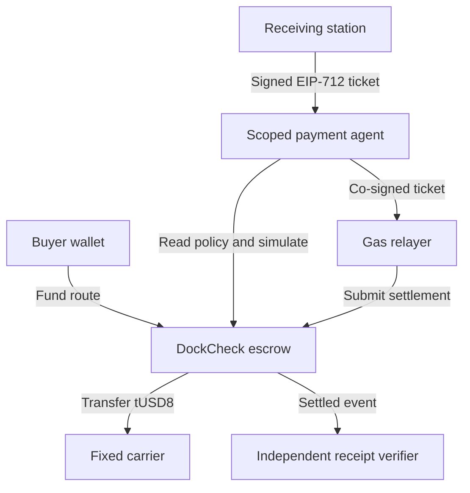

# DockCheck

**Pay the carrier for the crates the receiving dock actually accepts.** A produce buyer funds a route in tUSD8. A receiving station signs the lot, accepted quantity and measured temperature range. A scoped agent checks the receipt and co-signs a fixed-rate payout to the carrier. The buyer can revoke the route and reclaim its unspent budget.

The example route runs from Kutaisi to Tbilisi. The example crate prices and temperature band are fictional contract terms. Each buyer sets terms for its own cargo.

**Try the mined receipt first.** Open **View pilot receipt**, choose **Check carrier invoice**, then **Compare invoice**. The editable example bills eight crates at 0.08 tUSD8. The signed receipt records six crates and a 0.06 payment. DockCheck flags the two-crate, 0.02 tUSD8 difference. Correct the line to six crates and 0.06 and it matches. Print the report for the carrier or export JSON for accounts payable. Invoice details stay in the browser. The example shipment and invoice are fictional. The testnet payment is mined.

Use **Run local walkthrough**, then **Inspect route audit**, to verify a separate local escrow lifecycle. **Verify payment** checks one Aevum transaction. **Audit a route** reconstructs the funding, payout and refund from three hashes without connecting a wallet.

## Start here

| What you want to do | Where to start |
| --- | --- |
| Try the full local flow on Windows | Install Node.js 22.12 or newer, extract the ZIP, double-click **START-WINDOWS.cmd**. |
| Try it on macOS or Linux | From the extracted directory run **node scripts/serve.mjs** and open **http://127.0.0.1:4173**. |
| Run without Node | Load the packaged Linux/amd64 image using the commands below. |
| Watch a short demo | Open **delivery/DockCheck-demo.mp4**. It plays back a recorded local Solidity execution. |
| Run on QDay Aevum | Open **docs/AEVUM.md**. The browser supports deployment with a wallet. The CLI supports separated station, agent and relayer processes. |
| Present or submit | **docs/PITCH.md** includes the live demo script, submission copy, business assumptions and the mined evidence links. |

From a GitHub source checkout, run `npm ci && npm run build` before launching the desk. The prebuilt ZIP has no package-install step, bundled fonts and an in-browser EVM. The LOCAL units in the rehearsal exist only in that tab. Reloading starts a new rehearsal. The public-testnet mode uses the official token on chain 44005.

### First delivery

1. Leave **In range** selected. The buyer has 4.50 LOCAL in escrow. The dock has accepted six crates between 2.4 °C and 6.7 °C.
2. Choose **Review delivery**. Inspect the recipient, chain, lot commitment and quoted 0.75. Choose **Confirm settlement**. Escrow falls to 3.75 and the carrier has received 0.75.
3. Choose **Warm load**, then **Review delivery**. A 10.3 °C maximum breaks the agreed 8 °C ceiling. The contract simulation rejects it and no transfer is broadcast. **Replay last** reuses the previously settled signed receipt. The one-payment-per-lot rule rejects it.
4. Open **Route policy**, then **Review revocation**. Confirm the refund of the remaining 3.75. **Export evidence** downloads transaction and signature data. Holds are labeled as off-chain preflight decisions.

### Docker

The downloadable project ZIP includes a loadable image without any npm or blockchain service dependency for the rehearsal.

```sh
docker load -i delivery/dockcheck-linux-amd64.tar
docker run --rm -p 127.0.0.1:8080:8080 dockcheck:1.0
```

Open http://127.0.0.1:8080. On a different architecture, run `docker build -t dockcheck:1.0 .` with the included Dockerfile. The Go server runs as UID 65532. HTTPS or localhost is required for browser cryptography. No wallet is needed for the local flow.

## Rebuild, test and reproduce the evidence

Use Node.js 22.12+ and npm. Run commands from the directory containing package.json.

```sh
npm ci
npm test
npm run build
npm run demo
npm start
```

The included test report records 34 passing tests. One integration test uses a loopback-only Aevum-shaped fixture to exercise the full CLI, including a relayer restart. Tests compile the contracts with solc-js and execute the bytecode in Ganache. Coverage includes authorization, exact transfer amounts, conservation of the route budget, sender-independent relaying, freshness, expiry, revocation, duplicate lots, altered signatures, modified evidence, and reconstructing a lost receipt from calldata. The demo writes the fresh full transcript and signatures to `runtime-output/local-run.json`. Each run uses new local addresses and hashes. This is a functional test suite, not a security audit.

## Architecture



| Path | Responsibility |
| --- | --- |
| contracts/DockCheck.sol | Fixed token, escrow budgets, immutable route terms, dual EIP-712 signatures, expiry, replay prevention and refunds |
| src/protocol.mjs | Reusable signing, simulation, settlement and network checks |
| src/audit.mjs | Reconciles a single-payment route from three canonical transaction receipts |
| src/verify.mjs | Independently verifies a receipt against chain data or reconstructs the signed proof from a transaction hash |
| src/app.mjs, public/ | Responsive receiving desk, transparent transfer review, local EVM rehearsal and Aevum wallet workflow |
| scripts/agent.mjs | One-shot or directory-watching worker with durable signed-transaction journal |
| scripts/route.mjs, scripts/ticket.mjs | Buyer and receiving-station command-line entry points |
| artifacts/standard-input.json | All source inputs and deterministic compilation settings for verification |
| evidence/ | Mined public pilot, compiled source comparison and a separate local rehearsal |
| docs/PROTOCOL.md | Types, APIs, threat model, recovery behavior, platform choices and pilot roadmap |

## Evidence and submission status

The completed pilot on Aevum chain **44005** escrowed **0.10 tUSD8**, paid **0.06** and refunded **0.04**. Settlement was included in block **3,950,073**. The verifier checks the station and agent signatures, actual token transfers and the closed escrow. [Public receipt packet](evidence/aevum-pilot.json) · [funding](https://explorer-test.qday.info/tx/0xa9534597038e065c352d880b9b53c7d85879dbe177278ff1eceaca3179702099) · [settlement](https://explorer-test.qday.info/tx/0xb0dde94cdef82452a2113eae4a74871ef5e432ea528bccf8c684e7623c0030ad) · [refund](https://explorer-test.qday.info/tx/0x3f0a89e1bd8226661836f791923a0591cee3a5e9acb7f0f2ccb3a20c04822c0a).

The deployed contract is `0x181BA084DCb2946EB65Cb020B85dA5e8ED44431e`. Run `npm run verify:source` to compile the published source input and check both deployment calldata and runtime bytecode against the RPC. Run `npm run audit -- evidence/aevum-pilot.json` for a fresh read of the three transactions. An explorer-issued verification badge is unconfirmed. [Runtime comparison](evidence/aevum-source-match.json) · [contract](https://explorer-test.qday.info/address/0x181BA084DCb2946EB65Cb020B85dA5e8ED44431e) · [deployment](https://explorer-test.qday.info/tx/0xb1432ef83b86d979c1f687fd3a10967c85c51d65bffd10474043e7964781f1ea).

The starter app reports a Shanghai EVM target and a limit of 1,000 blocks per log query. DockCheck uses Shanghai, reads over HTTPS, and caps a browser log sync at 1,000 blocks. There are no server-side secrets or privileged contract administrator.

See [ten competing project concepts and the resulting product choices](docs/JUDGE-BENCHMARK.md) and [the original judge questions](docs/JUDGING.md).

## License and sources

Application code is MIT. See LICENSE, NOTICE.md and licenses/. Network configuration and challenge rules come from the organizer.

- Challenge and submission rules — https://qday.io/builder-challenge
- Starter application and current integration notes — https://aevum-starter-kit.vercel.app/
- Official token registry — https://wiki.qday.info/Knowledge/reference/tokens
- Network parameters — https://wiki.qday.info/Knowledge/reference/chains
- Contract verification overview — https://wiki.qday.info/guide/faq/
