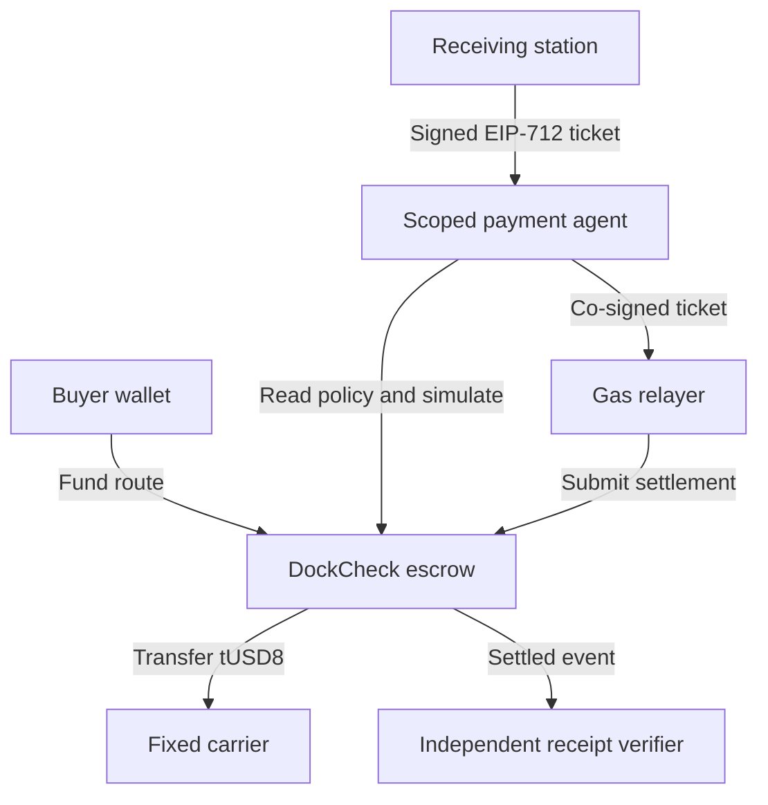

# DockCheck

**Pay the carrier for the crates the receiving dock actually accepts.** A produce buyer funds a route in tUSD8. A receiving station signs the lot, accepted quantity and measured temperature range. A scoped agent checks the receipt and co-signs a fixed-rate payout to the carrier. The buyer can revoke the route and reclaim its unspent budget.

The example route runs from Kutaisi to Tbilisi. The example crate prices and temperature band are fictional contract terms. Each buyer sets terms for its own cargo.

Open the public receiving desk: https://dockcheck-aevum-receiving.fruitfulchina3.chatgpt.site

[Watch the short demo](https://dockcheck-aevum-receiving.fruitfulchina3.chatgpt.site/DockCheck-demo.mp4) · [Download the prebuilt project](https://dockcheck-aevum-receiving.fruitfulchina3.chatgpt.site/DockCheck-Aevum.zip)

Use **Run the walkthrough** for a six-step rehearsal on the compiled contract. A live Aevum settlement can be checked from its hash with **Verify an Aevum payment**, without connecting a wallet.

## Start here

| What you want to do | Where to start |
| --- | --- |
| Try the full local flow on Windows | Install Node.js 22.12 or newer, extract the ZIP, double-click **START-WINDOWS.cmd**. |
| Try it on macOS or Linux | From the extracted directory run **node scripts/serve.mjs** and open **http://127.0.0.1:4173**. |
| Run without Node | Load the packaged Linux/amd64 image using the commands below. |
| Watch a short demo | Open **delivery/DockCheck-demo.mp4**. It plays back a recorded local Solidity execution. |
| Run on QDay Aevum | Open **docs/AEVUM.md**. The browser supports deployment with a wallet. The CLI supports separated station, agent and relayer processes. |
| Present or submit | **docs/PITCH.md** includes the live demo script, submission copy, business assumptions and outstanding evidence fields. |

From a GitHub source checkout, run `npm ci && npm run build` before launching the desk. The prebuilt ZIP has no package-install step, bundled fonts and an in-browser EVM. The LOCAL units in the rehearsal exist only in that tab. Reloading starts a new rehearsal. The public-testnet mode uses the official token on chain 44005.

### First delivery

1. Leave **In range** selected. The buyer has 4.50 LOCAL in escrow. The dock has accepted six crates between 2.4 °C and 6.7 °C.
2. Choose **Review delivery**. Inspect the recipient, chain, lot commitment and quoted 0.75. Choose **Confirm settlement**. Escrow falls to 3.75 and the carrier has received 0.75.
3. Choose **Warm load**, then **Review delivery**. A 10.3 °C maximum breaks the agreed 8 °C ceiling. The contract simulation rejects it and no transfer is broadcast. **Replay last** reuses the previously settled signed receipt. The one-payment-per-lot rule rejects it.
4. Open **Route policy**, then **Review revocation**. Confirm the refund of the remaining 3.75. **Export evidence** downloads transaction and signature data. Holds are labeled as off-chain preflight decisions.

### Docker

The ZIP includes a loadable image without any npm or blockchain service dependency for the rehearsal.

```sh
docker load -i delivery/dockcheck-linux-amd64.tar
docker run --rm -p 127.0.0.1:8080:8080 dockcheck:1.0
```

Open http://127.0.0.1:8080. On a different architecture, run `docker build -t dockcheck:1.0 .` with the included Dockerfile. The Go server runs as UID 65532. HTTPS or localhost is required for browser cryptography. No wallet is needed for the local flow.

## Rebuild, test and reproduce the evidence

Use Node.js 22.12+ and npm. Run commands from the directory containing package.json.

```sh
npm ci
npm test
npm run build
npm run demo
npm start
```

The included test report records 28 passing tests. One integration test uses a loopback-only Aevum-shaped fixture to exercise the full CLI, including a relayer restart. Tests compile the contracts with solc-js and execute the bytecode in Ganache. Coverage includes authorization, exact transfer amounts, conservation of the route budget, sender-independent relaying, freshness, expiry, revocation, duplicate lots, altered signatures, modified evidence, and reconstructing a lost receipt from calldata. The demo writes the fresh full transcript and signatures to `runtime-output/local-run.json`. Each run uses new local addresses and hashes. This is a functional test suite, not a security audit.

## Architecture



| Path | Responsibility |
| --- | --- |
| contracts/DockCheck.sol | Fixed token, escrow budgets, immutable route terms, dual EIP-712 signatures, expiry, replay prevention and refunds |
| src/protocol.mjs | Reusable signing, simulation, settlement and network checks |
| src/verify.mjs | Independently verifies a receipt against chain data or reconstructs the signed proof from a transaction hash |
| src/app.mjs, public/ | Responsive receiving desk, transparent transfer review, local EVM rehearsal and Aevum wallet workflow |
| scripts/agent.mjs | One-shot or directory-watching worker with durable signed-transaction journal |
| scripts/route.mjs, scripts/ticket.mjs | Buyer and receiving-station command-line entry points |
| artifacts/standard-input.json | All source inputs and deterministic compilation settings for verification |
| evidence/ | A real Aevum **read** and a separate **local** settlement transcript |
| docs/PROTOCOL.md | Types, APIs, threat model, recovery behavior, platform choices and pilot roadmap |

## Evidence and submission status

The build includes an Aevum chain/token read in `evidence/aevum-network.json`. It records the block, token address, decimals, and runtime hash. The official RPC also executed the contract constructor via `npm run simulate:aevum`. Its returned bytecode matched the local build byte-for-byte. The simulation is recorded in `evidence/aevum-deployment-simulation.json`. The recorded payments in `evidence/local-run.json` use chain 31337. Public contract deployment, a real Aevum payment, and explorer source-verification status still need to be added for submission. Instructions for each are in docs/AEVUM.md and docs/PITCH.md.

The starter app reports a Shanghai EVM target and a limit of 1,000 blocks per log query. DockCheck uses Shanghai, reads over HTTPS, and caps a browser log sync at 1,000 blocks. There are no server-side secrets or privileged contract administrator.

Read [the ten judging questions](docs/JUDGING.md) for the rationale behind this release.

## License and sources

Application code is MIT. See LICENSE, NOTICE.md and licenses/. Network configuration and challenge rules come from the organizer.

- Challenge and submission rules — https://qday.io/builder-challenge
- Starter application and current integration notes — https://aevum-starter-kit.vercel.app/
- Official token registry — https://wiki.qday.info/Knowledge/reference/tokens
- Network parameters — https://wiki.qday.info/Knowledge/reference/chains
- Contract verification overview — https://wiki.qday.info/guide/faq/
