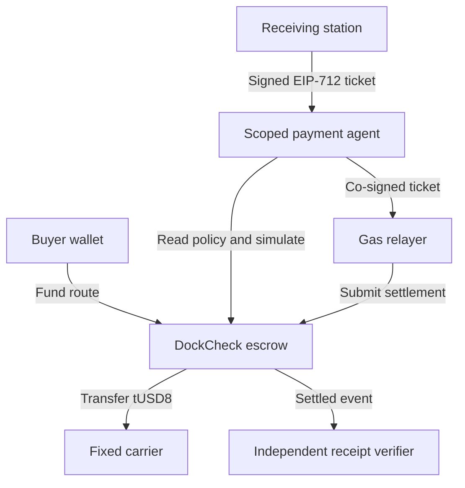

# DockCheck

Receiving stations can open **Receive a delivery and sign a ticket**, enter their route and actual measurements, review the ticket, sign with their assigned wallet, and download agent-compatible JSON. The agent consumes it with `npm run agent -- ticket.json`. Use the same physical lot reference on every retry. A full 32-byte lot ID is preserved for CLI interoperability. Other references are uppercased and hashed. The station attests to the measurements.

**Pay the carrier for the crates the receiving dock actually accepts.** A produce buyer funds a route in tUSD8. A receiving station signs the lot, accepted quantity and measured temperature range. A scoped agent checks the receipt and co-signs a fixed-rate payout to the carrier. The buyer can revoke the route and reclaim its unspent budget.

The example route runs from Kutaisi to Tbilisi. The example crate prices and temperature band are fictional contract terms. Each buyer sets terms for its own cargo.

## Run the release

Download **DockCheck-1.2.0.zip** from the [GitHub release](https://github.com/novruzovimose-cmd/dockcheck-aevum/releases/tag/v1.2.0) and extract the whole archive. Choose the named release asset for the prebuilt application.

| Platform | Start |
| --- | --- |
| Windows x64 | Double-click **START-WINDOWS.cmd**. The bundled server opens your default browser. Keep the console open while working. |
| Linux x64 | From the extracted DockCheck directory run `chmod +x delivery/dockcheck-linux-amd64 && ./delivery/dockcheck-linux-amd64 -listen 127.0.0.1:4173 -root dist`. |
| macOS or another OS with Node 22.12+ | Run `node scripts/serve.mjs` from the extracted project. |
| Docker | Follow the image instructions below. |

Open **http://127.0.0.1:4173** for the native and Node launchers. The application opens in the Aevum receipt workspace. Paste a settlement hash to verify a carrier payment and check an invoice line without connecting a wallet. **View mined receipt** opens the included public example even offline. Example site names, deliveries and invoice fields are fictional. Live route creation, payment and fresh verification use the public testnet.

### Operate a route

Open **Open buyer workspace → Connect to Aevum → Use existing contract**. Set the carrier, station and agent public addresses, budget, unit price, crate cap, temperature band and expiry. Review the terms before funding. Use **Export route configuration** to hand the public identifiers to the station and agent, who sign from their own machines. To resume after a restart, reconnect and select **Resume existing route**. Use the [operator guide](docs/AEVUM.md) for signing, relaying, evidence recovery and refunds.

### Develop and package

From a clean Git checkout, run `npm ci` and `npm run dev`. The development server builds Solidity and the browser bundle, watches source changes and serves localhost. Refresh the browser after an edit. Use `npm test` for the regression suite. Use `npm run build && npm start` for a single build.

To assemble a versioned distribution on Linux, install Python 3.10+ and a Go compiler (the release pipeline uses Go 1.25.x), then run `npm run package`. Package assembly reads Git-tracked source, compiled assets and cross-compiled Windows/Linux x64 launchers. Its output includes the Docker image, demo film, source, notices, evidence and a checksum manifest. Run `python3 scripts/check_release.py release/DockCheck-1.2.0.zip`. Each package also has an external SHA-256 file. See [release notes](docs/RELEASE.md).

### Judge walkthrough

Open **View mined receipt → Check carrier invoice → Compare invoice**. Eight crates billed against six accepted flags a 0.02 tUSD8 discrepancy. Correct the quantities and total to see a match. **Recheck on Aevum** reads the three transaction receipts. The short local execution film is in `delivery/DockCheck-demo.mp4`. See [presentation notes](docs/PITCH.md).

### First delivery in the developer rehearsal

1. Open the network menu and choose **Start local rehearsal**. Leave **In range** selected. The buyer has 4.50 LOCAL in escrow. The dock has accepted six crates between 2.4 °C and 6.7 °C.
2. Choose **Review delivery**. Inspect the recipient, chain, lot commitment and quoted 0.75. Choose **Confirm settlement**. Escrow falls to 3.75 and the carrier has received 0.75.
3. Choose **Warm load**, then **Review delivery**. A 10.3 °C maximum breaks the agreed 8 °C ceiling. The contract simulation rejects it and no transfer is broadcast. **Replay last** reuses the previously settled signed receipt. The one-payment-per-lot rule rejects it.
4. Open **Route policy**, then **Review revocation**. Confirm the refund of the remaining 3.75. **Export evidence** downloads transaction and signature data. Holds are labeled as off-chain preflight decisions.

### Docker

The downloadable project ZIP includes a loadable image without any npm or blockchain service dependency for the rehearsal.

```sh
docker load -i delivery/dockcheck-linux-amd64.tar
docker run --rm -p 127.0.0.1:8080:8080 dockcheck:1.2.0
```

Open http://127.0.0.1:8080. On a different architecture, run `docker build -t dockcheck:1.2.0 .` with the included Dockerfile. The Go server runs as UID 65532. HTTPS or localhost is required for browser cryptography. No wallet is needed for the local flow.

## Rebuild, test and reproduce the evidence

Use Node.js 22.12+ and npm. Run commands from the directory containing package.json.

```sh
npm ci
npm test
npm run build
npm run demo
npm start
```

The included test report records 37 passing tests. One integration test uses a loopback-only Aevum-shaped fixture to exercise the full CLI, including a relayer restart. Tests compile the contracts with solc-js and execute the bytecode in Ganache. Coverage includes authorization, exact transfer amounts, conservation of the route budget, sender-independent relaying, freshness, expiry, revocation, duplicate lots, altered signatures, modified evidence, and reconstructing a lost receipt from calldata. The demo writes the fresh full transcript and signatures to `runtime-output/local-run.json`. Each run uses new local addresses and hashes. This is a functional test suite, not a security audit.

## Architecture



| Path | Responsibility |
| --- | --- |
| contracts/DockCheck.sol | Fixed token, escrow budgets, immutable route terms, dual EIP-712 signatures, expiry, replay prevention and refunds |
| src/protocol.mjs | Reusable signing, simulation, settlement and network checks |
| src/audit.mjs | Reconciles a single-payment route from three canonical transaction receipts |
| src/verify.mjs | Independently verifies a receipt against chain data or reconstructs the signed proof from a transaction hash |
| src/app.mjs, public/ | Responsive receiving desk, transparent transfer review, local EVM rehearsal and Aevum wallet workflow |
| scripts/agent.mjs | One-shot or directory-watching worker with durable signed-transaction journal |
| scripts/route.mjs, scripts/ticket.mjs | Buyer and receiving-station command-line entry points |
| artifacts/standard-input.json | All source inputs and deterministic compilation settings for verification |
| evidence/ | Mined public pilot, compiled source comparison and a separate local rehearsal |
| docs/PROTOCOL.md | Types, APIs, threat model, recovery behavior, platform choices and pilot roadmap |

## Evidence and submission status

The completed pilot on Aevum chain **44005** escrowed **0.10 tUSD8**, paid **0.06** and refunded **0.04**. Settlement was included in block **3,950,073**. The verifier checks the station and agent signatures, actual token transfers and the closed escrow. [Public receipt packet](evidence/aevum-pilot.json) · [funding](https://explorer-test.qday.info/tx/0xa9534597038e065c352d880b9b53c7d85879dbe177278ff1eceaca3179702099) · [settlement](https://explorer-test.qday.info/tx/0xb0dde94cdef82452a2113eae4a74871ef5e432ea528bccf8c684e7623c0030ad) · [refund](https://explorer-test.qday.info/tx/0x3f0a89e1bd8226661836f791923a0591cee3a5e9acb7f0f2ccb3a20c04822c0a).

The deployed contract is `0x181BA084DCb2946EB65Cb020B85dA5e8ED44431e`. Run `npm run verify:source` to compile the published source input and check both deployment calldata and runtime bytecode against the RPC. Run `npm run audit -- evidence/aevum-pilot.json` for a fresh read of the three transactions. An explorer-issued verification badge is unconfirmed. [Runtime comparison](evidence/aevum-source-match.json) · [contract](https://explorer-test.qday.info/address/0x181BA084DCb2946EB65Cb020B85dA5e8ED44431e) · [deployment](https://explorer-test.qday.info/tx/0xb1432ef83b86d979c1f687fd3a10967c85c51d65bffd10474043e7964781f1ea).

The starter app reports a Shanghai EVM target and a limit of 1,000 blocks per log query. DockCheck uses Shanghai, reads over HTTPS, and caps a browser log sync at 1,000 blocks. There are no server-side secrets or privileged contract administrator.

See [ten competing project concepts and the resulting product choices](docs/JUDGE-BENCHMARK.md) and [the original judge questions](docs/JUDGING.md).

## License and sources

Application code is MIT. See LICENSE, NOTICE.md and licenses/. Network configuration and challenge rules come from the organizer.

- Challenge and submission rules — https://qday.io/builder-challenge
- Starter application and current integration notes — https://aevum-starter-kit.vercel.app/
- Official token registry — https://wiki.qday.info/Knowledge/reference/tokens
- Network parameters — https://wiki.qday.info/Knowledge/reference/chains
- Contract verification overview — https://wiki.qday.info/guide/faq/
